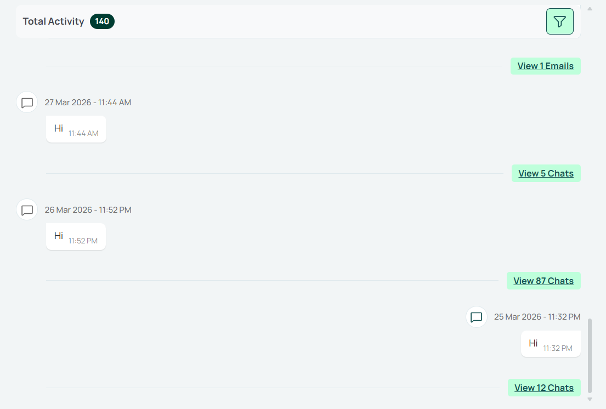
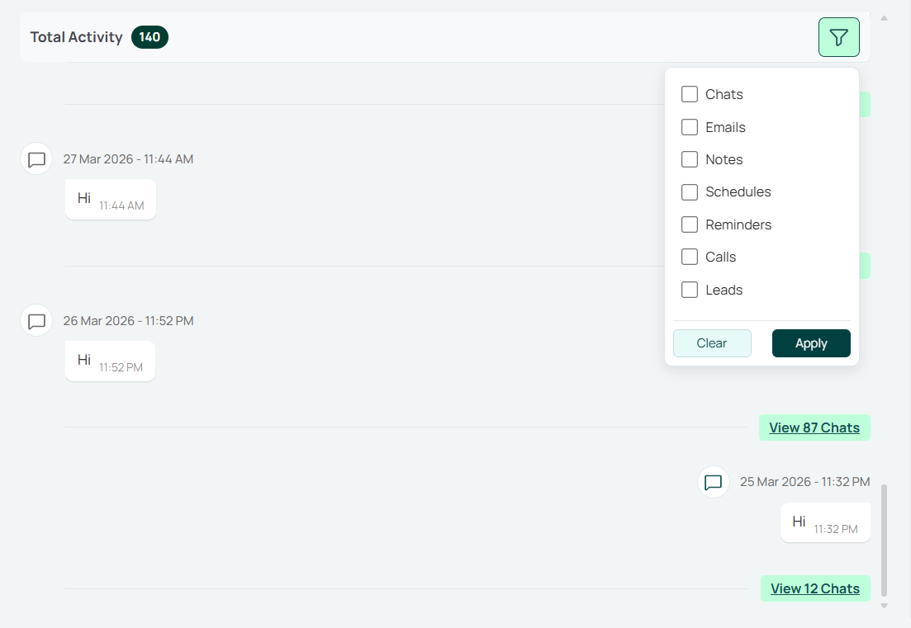

# React Activity Timeline Widget

A drop-in React timeline of every interaction with a CRM contact or lead: emails, WhatsApp and Raven chats, calls with recordings, notes, schedules, reminders, tasks, leads, briefs and quotations. It ships a Frappe-ready adapter and also works with any backend through its adapter interface.



## Contents

- [Key features](#-key-features)
- [Requirements](#-requirements)
- [Installation](#️-installation)
- [Quick start](#-quick-start)
- [Full integration example](#-full-integration-example)
- [Props](#️-props)
- [How it works](#-how-it-works)
- [Backend contract](#-backend-contract)
- [Supported activity types](#️-supported-activity-types)
- [Filtering](#-filtering)
- [Live updates (sockets)](#-live-updates-sockets)
- [Advanced customization](#️-advanced-customization)
- [Exports reference](#-exports-reference)
- [Styling](#-styling)
- [Development](#-development)
- [Changelog](#-changelog)
- [License](#-license)

## 🚀 Key Features

- **Unified widget**: `ActivityWidget` sets up its own provider, adapter and data fetching, so a host app needs one component and one CSS import.
- **Decoupled architecture**: data access goes through an adapter (`ActivityWidgetConfig`). Use the built-in Frappe adapter, or plug in your own `fetchActivities`.
- **Infinite scroll**: pages of 20 activities load automatically as the user scrolls, using an `IntersectionObserver`.
- **Live updates**: new activities arrive through the `onSocketMessage` bridge and are merged, de-duplicated and sorted with the fetched ones.
- **Filtering**: an activity-type filter, PDA/DC source toggles and a lead filter. The Emails filter can be preselected from the URL.
- **Grouping**: consecutive activities of the same type on the same day collapse into a "View N …" group. Chat groups read oldest-first, like a conversation.
- **Call recordings**: recordings are fetched with the auth header and played through `react-h5-audio-player`.
- **Email actions**: Reply and Reply All callbacks receive the parsed email (subject, body, sender, recipients, cc, bcc).
- **Rich cards**: Raven chat with image previews, briefs, leads, and quotations with a collapsible table of design lines.



## 📦 Requirements

| Dependency              | Version   | Notes                                                                                                                                                      |
| :---------------------- | :-------- | :--------------------------------------------------------------------------------------------------------------------------------------------------------- |
| `react` / `react-dom`   | `19.x`    | The published build is compiled with React 19's JSX runtime. `peerDependencies` also lists `^18`, but React 18 hosts are not supported by the current build. |
| `react-h5-audio-player` | `^3.x`    | Used for call recordings; its stylesheet is imported by the package.                                                                                      |
| `@phosphor-icons/react` | `^2.x`    | Listed as a peer dependency. The icons used by the widget are bundled into `dist`.                                                                         |

The widget is a client component. In Next.js App Router, render it from a file marked `"use client"`.

## 🛠️ Installation

```bash
# From npm (recommended)
npm install react-activity-timeline-widget@^1.3.0

# Or from Git
npm install https://github.com/8848digital/react-activity-timeline-widget.git
```

Install the peer dependencies if your app does not have them yet:

```bash
npm install react react-dom @phosphor-icons/react react-h5-audio-player
```

Import the stylesheet once, for example in your root layout or next to the widget:

```tsx
import "react-activity-timeline-widget/styles.css";
```

## ⚡ Quick start

The smallest working setup against a Frappe backend with the `crm_integration` app:

```tsx
"use client";
import { ActivityWidget } from "react-activity-timeline-widget";
import "react-activity-timeline-widget/styles.css";

export default function ContactActivity({ contactName }: { contactName: string }) {
  return (
    <ActivityWidget
      baseURL="https://crm.example.com"
      token="api_key:api_secret" // sent as `Authorization: token api_key:api_secret`
      contactName={contactName}
      currentUserEmail="agent@example.com"
    />
  );
}
```

## 📋 Full integration example

This is how the 8848 Digital CRM frontend wires the widget: the contact comes from a store, live updates come from a socket hook, and email replies open the host's composer.

```tsx
"use client";
import React, { useCallback, useRef } from "react";
import { ActivityWidget, type SocketMessage, type EmailReplyData } from "react-activity-timeline-widget";
import "react-activity-timeline-widget/styles.css";

// CRM project imports
import { API_BASE_URL, getAuthToken } from "@/services/config/apiClient";
import { useAssignedTaskStore } from "@/stores/assignedTaskStore";
import { useSearchParams } from "next/navigation";
import { useSocket } from "@/hooks/useSocket";
import useLeads from "@/hooks/lead/useLeads";
import { useEmailReplyStore } from "@/stores/emailReplyStore";
import { useAuthStore } from "@/stores/authStore";

const ActivityTabNpm = ({ type, title = "Activity" }: { type?: "contact" | "lead"; title?: string }) => {
  const searchParams = useSearchParams();
  const assignedTask = useAssignedTaskStore((s) => s.assignedTask);
  const token = getAuthToken() || "";

  // 1. Which record to show
  const contactName = type === "lead" ? searchParams.get("lead_name") || null : assignedTask?.contact?.name || null;

  // 2. Socket bridge
  // Keep socket traffic out of React state so this component does not re-render on every message.
  // The widget subscribes once via `onSocketMessage(handler)`; the handler is kept in a ref.
  const socketHandlerRef = useRef<((msg: SocketMessage) => void) | null>(null);
  useSocket((msg) => {
    const safeMsg: SocketMessage = {
      event: msg.event,
      message: (msg as { message?: unknown }).message ?? {},
    };
    socketHandlerRef.current?.(safeMsg);
  });

  const onSocketMessage = useCallback((handler: (msg: SocketMessage) => void) => {
    socketHandlerRef.current = handler;
    return () => {
      // Only clear if we're unsubscribing the same handler (guards against stale cleanups).
      if (socketHandlerRef.current === handler) socketHandlerRef.current = null;
    };
  }, []);

  // 3. Email reply bridge
  const { openEmailComposer } = useEmailReplyStore();
  const currentUserEmail = useAuthStore((s) => s.email);
  const currentUserName = useAuthStore((s) => s.full_name);

  const handleEmailReply = useCallback(
    (data: EmailReplyData, isReplyAll = false) => {
      const personName = data.senderFullName || data.sender;
      const isSentByMe =
        (currentUserEmail && data.sender && data.sender.toLowerCase() === currentUserEmail.toLowerCase()) ||
        (currentUserName && data.senderFullName && data.senderFullName.toLowerCase() === currentUserName.toLowerCase());

      openEmailComposer({
        in_reply_to: data.name,
        subject: data.subject,
        to: isSentByMe && data.recipients ? data.recipients : data.sender,
        cc: isReplyAll ? data.cc || undefined : undefined,
        bcc: isReplyAll ? data.bcc || undefined : undefined,
        content: data.content,
        date: "",
        time: "",
        senderName: personName,
        attachments: [],
      });
    },
    [currentUserEmail, currentUserName, openEmailComposer]
  );

  const handleEmailReplyAll = useCallback((data: EmailReplyData) => handleEmailReply(data, true), [handleEmailReply]);

  // 4. Leads for the lead filter (synchronous getter, memoized)
  const customerName = assignedTask?.contact?.name ?? undefined;
  const { leads } = useLeads(undefined, customerName);
  const fetchLeads = useCallback(() => ({ leads: leads || [] }), [leads]);

  // 5. Memoize object props so host re-renders do not restart fetching
  const memoizedSearchParams = React.useMemo(
    () => ({
      activityId: searchParams.get("activityId"),
      comm_type: searchParams.get("comm_type"),
    }),
    [searchParams]
  );

  return (
    <ActivityWidget
      baseURL={API_BASE_URL}
      token={token}
      contactName={contactName}
      onSocketMessage={onSocketMessage}
      onEmailReply={handleEmailReply}
      onEmailReplyAll={handleEmailReplyAll}
      fetchLeads={fetchLeads}
      searchParams={memoizedSearchParams}
      currentUserEmail={currentUserEmail}
      type={type}
      title={title}
    />
  );
};

export default ActivityTabNpm;
```

> **Keep props stable.** The adapter config is memoized on every prop. A callback or object that is recreated on each render (an inline `onSocketMessage`, `fetchLeads` or `searchParams`) rebuilds the adapter and restarts fetching from the first page. Wrap them in `useCallback` / `useMemo` as above.

## ⚙️ Props

`ActivityWidget` accepts the following props (`ActivityWidgetProps`):

| Prop                      | Type                                                                   | Default      | Description                                                                                                                         |
| :------------------------ | :--------------------------------------------------------------------- | :----------- | :---------------------------------------------------------------------------------------------------------------------------------- |
| **Connection**            |                                                                        |              |                                                                                                                                     |
| `contactName`             | `string \| null`                                                       | -            | The contact (or lead) whose activities are shown. Nothing is fetched while it is `null`.                                            |
| `baseURL`                 | `string`                                                               | `"/"`        | Base URL prepended to API paths, e.g. `https://crm.example.com` (no trailing slash).                                                |
| `token`                   | `string`                                                               | -            | Frappe API credential. Sent as `Authorization: token <token>` on every request, typically `api_key:api_secret`.                     |
| `apiBaseUrl`              | `string`                                                               | `baseURL`    | Base URL for attachment and file links (`/files/...`, `/private/files/...`).                                                        |
| **UI**                    |                                                                        |              |                                                                                                                                     |
| `type`                    | `"contact" \| "lead"`                                                  | -            | Which kind of record `contactName` refers to. Passed through to the config.                                                         |
| `title`                   | `string`                                                               | `"Activity"` | Title used in the loading and error states.                                                                                         |
| `currentUserEmail`        | `string \| null`                                                       | -            | The signed-in user's email. Raven messages from this address are drawn as outbound (right-aligned).                                 |
| `searchParams`            | `Record<string, string \| null>`                                       | -            | Router state. `comm_type: "communication"` preselects the Emails filter on mount. `activityId` is accepted but not used yet.        |
| `className`               | `string`                                                               | -            | Accepted for API compatibility; not applied to the DOM in 1.3.0.                                                                    |
| **Callbacks**             |                                                                        |              |                                                                                                                                     |
| `onSocketMessage`         | `(handler: (msg: SocketMessage) => void) => () => void`                | -            | Subscribe the widget to your realtime stream. Call `handler` for every message and return an unsubscribe function.                 |
| `onEmailReply`            | `(data: EmailReplyData) => void`                                       | -            | Shows a **Reply** button on email cards and is called with the email when clicked.                                                  |
| `onEmailReplyAll`         | `(data: EmailReplyData) => void`                                       | -            | Shows a **Reply All** button; `data.isReplyAll` is `true` and `cc` / `bcc` are filled in.                                            |
| `fetchLeads`              | `() => { leads: Array<{ name: string }> }`                             | -            | **Synchronous** getter for the lead filter options. It is called during render, so return already-loaded data (not a Promise).      |
| `renderChatMessageList`   | `(props: { activity: WhatsAppActivity; icon: ReactNode; showIcon: boolean }) => ReactNode` | built-in `MessageList` | Custom renderer for the body of WhatsApp cards.                                                          |

`EmailReplyData`:

```ts
interface EmailReplyData {
  name?: string;          // Communication name, use it as in_reply_to
  subject: string;
  content: string;        // the email body HTML
  recipients: string;     // Reply: the sender; Reply All: the original "To"
  cc?: string | null;
  bcc?: string | null;
  sender?: string;
  senderFullName?: string;
  isReplyAll?: boolean;
}
```

## 🧭 How it works

```
ActivityWidget
 ├─ useDefaultActivityAdapter(props)   → ActivityWidgetConfig (fetchActivities, fetchCallRecording, …)
 └─ ActivityProvider (React context)
     └─ ActivityTab
         └─ useActivityTabLogic
             ├─ useFilterState      → filter UI state ⇄ API filter payload
             ├─ useActivities       → paged fetch + socket merge + de-dupe + sort (newest first)
             ├─ buildActivityNodes  → groups consecutive same-day, same-type items
             └─ IntersectionObserver on a sentinel → fetchNextPage()
         └─ <Activity> dispatches on activity_type → EmailActivity, ChatActivity, CallActivity, …
```

- Activities are sorted newest first by `communication_date`, then `creation`, then `modified`, then `date` + `time`.
- Consecutive items with the same `activity_type` and the same `creation` day are grouped. The first item is shown; the rest sit behind a "View N Emails / Chats / Calls / …" toggle.
- `attachment_log` items are hidden.
- Changing `contactName` or the filters clears the loaded pages and fetches the first page again. Socket items are cleared when `contactName` changes.

## 🔗 Backend contract

The built-in adapter calls two Frappe whitelisted methods from the `crm_integration` app. All requests carry `Authorization: token <token>`.

### `GET /api/method/crm_integration.crm_integration.api.activities.get_activities`

| Query param         | Value                                                                                       |
| :------------------ | :------------------------------------------------------------------------------------------ |
| `name`              | `contactName`                                                                               |
| `limit_start`       | The **page index** (`0`, `1`, `2`, …), taken from the previous response's `page + 1`.        |
| `limit_page_length` | `20`                                                                                        |
| `filters`           | Optional JSON, e.g. `{"activity_type":["communication","note"],"sources":["pd"],"lead":["CRM-LEAD-0001"]}` |

Expected response (`ActivityResponse`):

```json
{
  "message": {
    "activities": [{ "activity_type": "communication", "creation": "2026-10-30 10:15:00", "...": "..." }],
    "total_count": 135,
    "page": 0,
    "page_size": 20,
    "includes_pd": true,
    "includes_dc": false
  }
}
```

Another page is requested while `(page + 1) * page_size < total_count`. `includes_pd` / `includes_dc` (read from the first page) decide whether the PDA and DC toggle buttons are shown.

### `GET /api/method/crm_integration.crm_exotel.api.call_log.get_call_recording?call_log_id=<name>`

Returns `{ "message": { "url": "<stream url>" } }`. The widget then downloads that URL with the same auth header, turns it into a blob URL and plays it. This happens for call activities that have a `recording_url`.

## 🗂️ Supported Activity Types

Each activity is rendered by its `activity_type`. The filter label is what appears in the widget's filter, and the filter value is what is sent to the API.

| `activity_type` (rendered)        | Component           | Filter label  | Filter value    |
| :-------------------------------- | :------------------ | :------------ | :-------------- |
| `whatsapp`                        | `ChatActivity`      | WhatsApp Chat | `whatsapp`      |
| `communication`                   | `EmailActivity`     | Emails        | `communication` |
| `notes` / `creation`              | `NotesActivity`     | Notes         | `note`          |
| `Schedule`                        | `ScheduleActivity`  | Schedules     | `schedule`      |
| `Reminder`                        | `ReminderActivity`  | Reminders     | `reminder`      |
| `Task`                            | `TaskActivity`      | -             | -               |
| `outgoing_call` / `incoming_call` | `CallActivity`      | Calls         | `call`          |
| `lead`                            | `LeadActivity`      | Leads         | `lead`          |
| `brief`                           | `BriefActivity`     | Brief         | `brief`         |
| `raven`                           | `RavenActivity`     | Raven Message | `raven`         |
| `quotation`                       | `QuotationActivity` | Quotations    | `quotation`     |

Items with any other `activity_type` are skipped.

Badges: any activity with `is_lead` shows a **Lead** badge, `is_pd` shows **PDA** and `is_dc` shows **DC**.

### Card notes

- **Email** (`communication`): From, To, Cc, Bcc, subject, HTML body and attachments. Long bodies collapse behind "View More". `data.sent_or_received === "Received"` adds a blue left border and a "Received" badge.
- **WhatsApp**: links in the text become clickable; `attach` with `content_type: "image"` is shown inline, other attachments as a link. Delivery ticks show for outbound messages (`status` 1 sent, 2 failed, 3 delivered, 4 read, 5 pending).
- **Raven**: messages from `currentUserEmail` are outbound. `message_type: "Image"` with a `file` shows an image preview.
- **Call**: inbound or outbound label, status badge, caller and receiver (`_caller.label`, `_receiver.label`), duration (`_duration`) and the recording player.
- **Schedule / Reminder / Task**: title, due date, priority, type and status; Tasks with status `Skipped` also show the skip reason.

### Quotation activity

Added in **1.3.0**. The backend sends one item per quotation; its types are exported as `QuotationActivityType` and `QuotationItem`:

```ts
import type { QuotationActivityType, QuotationItem } from "react-activity-timeline-widget";

const example: QuotationActivityType = {
  activity_type: "quotation",
  name: "QTN-0001",
  creation: "2026-10-30 10:15:00",
  quotation_no: "QTN-0001",
  company: "8848 Digital",
  quotation_date: "2026-10-30",
  customer_code: "CUST-001",
  currency: "INR",
  po_no: null,
  remarks: null,
  sales_person: "Jane Doe",
  created_by: "jane@example.com",
  last_modified: null,
  leads: ["CRM-LEAD-0001"],
  is_lead: true, // shows the "Lead" badge
  item_count: 2,
  total_qty: 3,
  total_amount: 45000,
  items: [
    { sr: 1, design_code: "D-100", suffix: null, size: "12", karat: "18K", colour: "Yellow", qty: 1, rate: 15000, amount: 15000 },
    { sr: 2, design_code: "D-200", suffix: null, size: null, karat: "22K", colour: null, qty: 2, rate: 15000, amount: 30000 },
  ],
};
```

The card shows the first 3 design lines and a "View all N designs" toggle for the rest. Optional fields (`customer_code`, `po_no`, `sales_person`, `created_by`, `remarks`, `leads`) are hidden when empty. Quotations grouped on the same date show as "View N Quotations".

## 🔍 Filtering

- **Activity type**: the funnel button opens a checklist of the labels above. **Apply** sends the mapped values as `filters.activity_type`; **Clear** removes every filter, including sources and lead.
- **Sources**: the **PDA** and **DC** buttons toggle `filters.sources` (`pd`, `dc`). They only appear when the first page reports `includes_pd` / `includes_dc`.
- **Lead**: `fetchLeads()` provides the options; a selected lead is sent as `filters.lead`.
- **Preselect from the URL**: pass `searchParams={{ comm_type: "communication" }}` to open the widget with the Emails filter applied.

You can reuse the mapping in your own UI with `useFilterState` and `ACTIVITY_TYPE_LABELS`.

## 🔌 Live updates (sockets)

`onSocketMessage` receives a handler; call it with `{ event, message }` for each realtime message. These events are turned into timeline items:

| Socket `event`     | Becomes `activity_type`                                       |
| :----------------- | :------------------------------------------------------------ |
| `whatsapp_message` | `whatsapp`                                                    |
| `communication`    | `communication`                                               |
| `fcrm_note`        | `notes`                                                       |
| `crm_task`         | `Reminder` when `task_type` (or `type`) is `Reminder`, otherwise `Schedule` |
| `crm_lead`         | `lead`                                                        |
| `crm_call_log`     | `incoming_call` when `type` is `Incoming`, otherwise `outgoing_call` |
| `raven_message`    | `raven`                                                       |
| `activity`         | `brief`                                                       |

`message` must be the document as the API would return it. An item whose `name` matches one already loaded replaces it, so updates to an existing document are applied in place. The widget does not check which contact a message belongs to, so **forward only events for the record on screen**.

A minimal `useSocket` hook for socket.io:

```tsx
// your-app/hooks/useSocket.ts
import { useEffect, useRef } from "react";
import { io } from "socket.io-client";

export interface SocketMessage {
  event: string;
  message?: any;
}

export const useSocket = (onMessage: (data: SocketMessage) => void) => {
  const onMessageRef = useRef(onMessage);

  useEffect(() => {
    onMessageRef.current = onMessage;
  }, [onMessage]);

  useEffect(() => {
    const socket = io("YOUR_SOCKET_URL", {
      reconnection: true,
      reconnectionAttempts: 10,
      reconnectionDelay: 2000,
      transports: ["websocket", "polling"],
      extraHeaders: {
        Authorization: `token ${YOUR_TOKEN}`,
      },
    });

    socket.onAny((eventName, data) => {
      onMessageRef.current({ event: eventName, message: data });
    });

    return () => {
      socket.disconnect();
    };
  }, []);
};
```

## ⚙️ Advanced Customization

### Lower-level components

If `ActivityWidget` is too opinionated, compose the pieces yourself:

```tsx
import { ActivityProvider, ActivityTab, useDefaultActivityAdapter } from "react-activity-timeline-widget";

const CustomActivityPage = () => {
  const adapterConfig = useDefaultActivityAdapter({ baseURL, token, contactName });

  return (
    <ActivityProvider {...adapterConfig}>
      <div className="custom-wrapper">
        <ActivityTab />
      </div>
    </ActivityProvider>
  );
};
```

### Custom backend adapter

`ActivityProvider` accepts any `ActivityWidgetConfig`. Only `fetchActivities` and `contactName` are required:

```tsx
import { ActivityProvider, ActivityTab, type ActivityWidgetConfig } from "react-activity-timeline-widget";

const config: ActivityWidgetConfig = {
  contactName: "CONTACT-0001",
  apiBaseUrl: "https://files.example.com",
  fetchActivities: async ({ contactName, limit_start, limit_page_length, filters }) => {
    const res = await fetch(`/my-api/activities?contact=${encodeURIComponent(contactName)}&page=${limit_start}`);
    const body = await res.json();
    return {
      message: {
        activities: body.items,      // ActivityItem[]
        total_count: body.total,
        page: limit_start,
        page_size: limit_page_length,
      },
    };
  },
  // Optional:
  fetchCallRecording: async (callLogId) => `/my-api/recordings/${callLogId}`,
  fetchCallRecordingBlob: async (url) => (await fetch(url)).blob(),
  onEmailReply: (data) => console.log("reply", data),
};

export const MyTimeline = () => (
  <ActivityProvider {...config}>
    <ActivityTab />
  </ActivityProvider>
);
```

Memoize `config` (for example with `useMemo`) when it is built inside a component.

## 📚 Exports reference

| Kind       | Exports                                                                                                                                                                                                                                 |
| :--------- | :-------------------------------------------------------------------------------------------------------------------------------------------------------------------------------------------------------------------------------------- |
| Components | `ActivityWidget`, `ActivityTab`, `Activity`, `ActivityDateGroup`, `ActivityFilter`, `EmailActivity`, `EmailRecipientRow`, `NotesActivity`, `ChatActivity`, `CallActivity`, `CallNotesActivity`, `ScheduleActivity`, `TaskActivity`, `ReminderActivity`, `LeadActivity`, `QuotationActivity` |
| Context    | `ActivityProvider`, `useActivityConfig`                                                                                                                                                                                                 |
| Hooks      | `useDefaultActivityAdapter`, `useActivityTabLogic`, `useActivities`, `useFilterState`, `useCallRecording`, `useExpandableContent`                                                                                                        |
| API        | `createDefaultApiClient(baseURL, token)`, `activityApi(client)`                                                                                                                                                                         |
| Utils      | `parseDateTime`, `getActivityDateKey`, `getDateKeyFromActivity`, `getActivityDate`, `getActivityTimestamp`, `buildActivityNodes`, `getActivityElementId`, `formatDuration`, `getBadgeColor`, `sanitizeHtmlLight`, `formatTimeLocale`, `parseMessageWithLinks`, `renderMessageStatusIcon` |
| Constants  | `ACTIVITY_TYPE_LABELS`                                                                                                                                                                                                                  |
| Types      | `ActivityWidgetProps`, `ActivityWidgetConfig`, `DefaultActivityAdapterParams`, `UseActivityTabLogicReturn`, `ActivityItem`, `ActivityNode`, `ActivityMessage`, `ActivityResponse`, `FetchActivitiesParams`, `SocketMessage`, `EmailReplyData`, and one type per card (`CommunicationActivity`, `NotesActivityType`, `CreationActivity`, `ScheduleActivityType`, `ReminderActivityType`, `TaskActivityType`, `WhatsAppActivity`, `CallActivityType`, `LeadActivityType`, `BriefActivityType`, `RavenActivityType`, `QuotationActivityType`, `QuotationItem`) |

Dates such as `"2026-10-30 10:15:00"` are parsed with the browser's `Date`, so they are shown in the viewer's local timezone. `parseDateTime` formats them as `30 Oct 2026` and `10:15 AM`.

## 🎨 Styling

- Import `react-activity-timeline-widget/styles.css` once. It also pulls in the `react-h5-audio-player` styles.
- All classes are plain CSS: widget-level classes use the `atw-` prefix (`atw-sticky-header`, `atw-filter-panel`, …) and cards use `activity-*`, `email-activity-*`, `chat-*`, `call-activity-*`, `quotation-activity-*` and so on. Override them from your own stylesheet.
- HTML bodies (emails, notes, descriptions) are rendered inside `.rich-html-content`.

## 🧑‍💻 Development

```bash
npm install        # also runs "prepare", which builds dist/
npm run dev        # Vite dev server
npm run build      # tsc type-check, then Vite library build to dist/
npx tsc --noEmit   # type-check only
```

- Source lives in `src/` (`api`, `components`, `context`, `hooks`, `types`, `utils`, `styles`). The library entry is `src/index.ts`.
- The build outputs `dist/index.mjs` (ESM), `dist/index.js` (UMD/CJS), `dist/index.css` and type declarations. `dist/` is committed, so rebuild before committing source changes.
- `npm run lint` is defined, but the repo has no ESLint config yet, so it currently fails to start.

### Releasing

1. Update the code and the [Changelog](#-changelog).
2. `npm run build` and commit `dist/`.
3. `npm version <patch|minor|major>`, then `npm publish`.

## 📝 Changelog

### 1.3.0

- New `QuotationActivity` card for `activity_type: "quotation"`, with a collapsible table of design lines and the Lead badge from `is_lead`.
- New exported types `QuotationActivityType` and `QuotationItem`, and an exported `QuotationActivity` component.
- "Quotations" option in the activity-type filter and a "View N Quotations" group label.

### 1.2.4

- The Notes filter now sends `note` (was `notes`) so the API returns the right items. Rendered items still use `activity_type: "notes"`.

### 1.2.3

- Fixed "load more": the infinite-scroll observer is re-attached when new activities arrive, so later pages keep loading.

### 1.2.1 – 1.2.2

- Scrolling fixes for the timeline, and email card UI fixes.

### 1.2.0

- New Raven message activity (`raven`) with inbound/outbound styling and image previews.
- PDA and DC source filters, shown when the API reports `includes_pd` / `includes_dc`.
- Socket support for `raven_message` and `activity` events.

### 1.1.0

- New Brief activity (`brief`).
- Badges (Lead, PDA, DC) to show activities that come from other portals.

### 1.0.0

- Initial release: activity timeline with the adapter architecture, infinite scroll, filters, socket updates and authenticated call-recording playback.

## 📄 License

MIT
