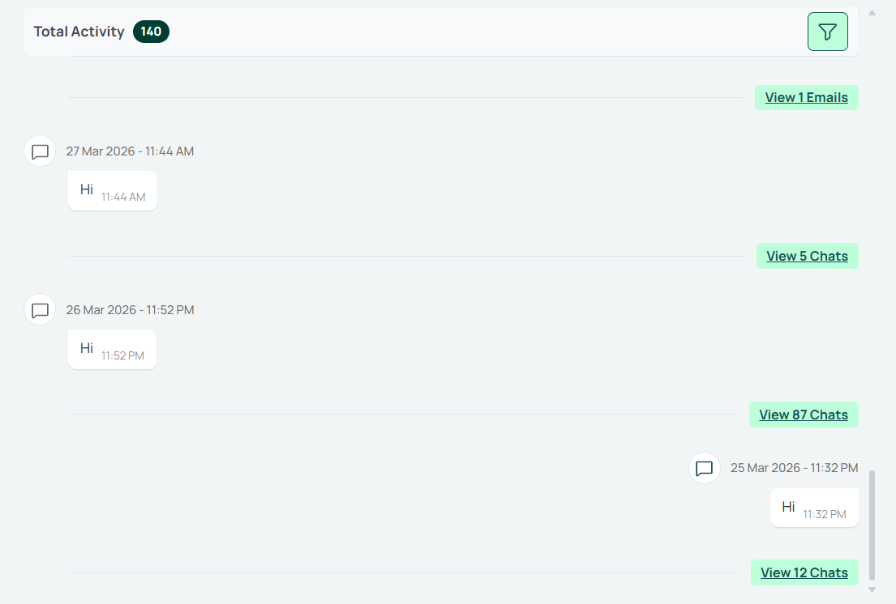
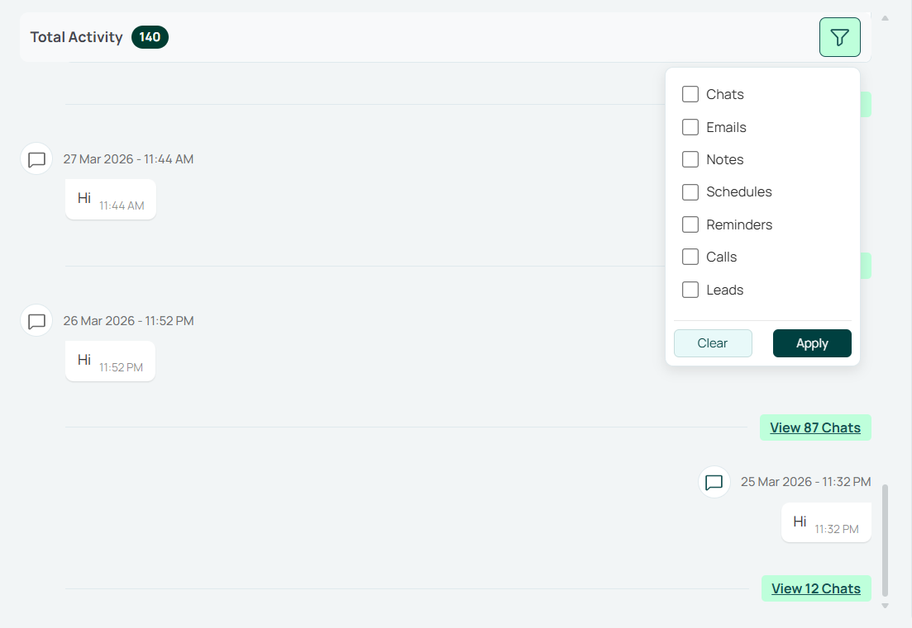

# React Activity Timeline Widget



## 🚀 Key Features

- **Decoupled Architecture**: Logic is separated from UI using an adapter pattern.
- **Unified Widget**: High-level `ActivityWidget` that handles Provider and Adapter internally for zero-boilerplate integration.
- **Live Updates**: Built-in support for Socket.io/WebSocket via the `onSocketMessage` bridge (now supports `raven_message` and `activity` events).
- **Raven Chat Integration**: Support for the new Raven chat type with inbound/outbound styling and image previews.
- **Quotation Cards**: EMR quotations linked to a customer or lead render with number, total, customer code, lead and a collapsible table of design lines.
- **Infinite Scroll**: Automated lazy loading and "fetch more" logic as you scroll.
- **Filtering**: Built-in filter state for communication types and related leads.



- **Adapters**: Flexible API adapters for Frappe-style backends or custom implementations.
- **Phosphor Icons**: Integrated premium icon set for consistent visual language.
- **Modular Components**: Access lower-level components like `ActivityTab` or `ActivityProvider` for highly custom layouts.

## 🛠️ Installation

```bash
# From npm (recommended)
npm install react-activity-timeline-widget@^1.3.0

# Or from Git
npm install https://github.com/8848digital/react-activity-timeline-widget.git
```

### Peer Dependencies

The widget requires following peer dependencies to be installed in your project:

```bash
npm install react react-dom @phosphor-icons/react react-h5-audio-player
```

## 📋 Usage

### 1. Optimized Integration (Recommended)

This is the easiest way to integrate. The `ActivityWidget` manages its own state, providers, and data-fetching logic.

```tsx
"use client";
import React, { useCallback, useRef } from "react";
import { ActivityWidget, type SocketMessage, type EmailReplyData } from "react-activity-timeline-widget";
import "react-activity-timeline-widget/styles.css";

// CRM Project Imports
import { API_BASE_URL, getAuthToken } from "@/services/config/apiClient";
import { useAssignedTaskStore } from "@/stores/assignedTaskStore";
import { useSearchParams } from "next/navigation";
import { useSocket } from "@/hooks/useSocket";
import useLeads from "@/hooks/lead/useLeads";
import { useEmailReplyStore } from "@/stores/emailReplyStore";
import { useAuthStore } from "@/stores/authStore";

/**
 * Optimized Activity Tab using the high-level ActivityWidget from react-activity-timeline-widget.
 * This version eliminates boilerplate by letting the package manage its own Provider and Context.
 */
const ActivityTabNpm = ({ type, title = "Activity" }: { type?: "contact" | "lead"; title?: string }) => {
  const searchParams = useSearchParams();
  const assignedTask = useAssignedTaskStore((s) => s.assignedTask);
  const token = getAuthToken() || "";

  // 1. Determine Contact Name
  const contactName = type === "lead" ? searchParams.get("lead_name") || null : assignedTask?.contact?.name || null;

  // 2. Socket Bridge
  // Keep socket traffic out of React state to avoid re-rendering this component on every message.
  // The widget subscribes once via `onSocketMessage(handler)`; we store that single handler in a ref.
  const socketHandlerRef = useRef<((msg: SocketMessage) => void) | null>(null);
  useSocket((msg) => {
    // Normalize to the widget's SocketMessage type (it requires `message`).
    const safeMsg: SocketMessage = {
      event: msg.event,
      message: (msg as { message?: unknown }).message ?? {},
    };
    socketHandlerRef.current?.(safeMsg);
  });

  const onSocketMessage = useCallback((handler: (msg: SocketMessage) => void) => {
    // Register (or replace) the current subscriber.
    socketHandlerRef.current = handler;
    return () => {
      // Only clear if we're unsubscribing the same handler (guards against stale cleanups).
      if (socketHandlerRef.current === handler) socketHandlerRef.current = null;
    };
  }, []);

  // 3. Email Reply Logic Bridge
  const { openEmailComposer } = useEmailReplyStore();
  const currentUserEmail = useAuthStore((s) => s.email);
  const currentUserName = useAuthStore((s) => s.full_name);

  const handleEmailReply = useCallback(
    (data: EmailReplyData, isReplyAll = false) => {
      const personName = data.senderFullName || data.sender;
      // Check email match first (reliable). Only fall back to full-name match
      // when both senderFullName and currentUserName exist (avoid comparing email vs name).
      const isSentByMe =
        (currentUserEmail && data.sender && data.sender.toLowerCase() === currentUserEmail.toLowerCase()) ||
        (currentUserName && data.senderFullName && data.senderFullName.toLowerCase() === currentUserName.toLowerCase());

      const replyToRecipient = isSentByMe && data.recipients ? data.recipients : data.sender;

      openEmailComposer({
        in_reply_to: data.name,
        subject: data.subject,
        to: replyToRecipient,
        cc: isReplyAll ? data.cc || undefined : undefined,
        bcc: isReplyAll ? data.bcc || undefined : undefined,
        content: data.content,
        date: "",
        time: "",
        senderName: personName,
        attachments: [],
      });
    },
    [currentUserEmail, currentUserName, openEmailComposer]
  );

  const handleEmailReplyAll = useCallback((data: EmailReplyData) => handleEmailReply(data, true), [handleEmailReply]);

  // 4. Leads for filter options
  const customerName = assignedTask?.contact?.name ?? undefined;
  const { leads } = useLeads(undefined, customerName);
  const fetchLeads = useCallback(() => ({ leads: leads || [] }), [leads]);

  // 5. Memoize UI parameters to prevent unnecessary re-fetching on host re-renders
  const memoizedSearchParams = React.useMemo(
    () => ({
      activityId: searchParams.get("activityId"),
      comm_type: searchParams.get("comm_type"),
    }),
    [searchParams]
  );

  return (
    <ActivityWidget
      baseURL={API_BASE_URL}
      token={token}
      contactName={contactName}
      onSocketMessage={onSocketMessage}
      onEmailReply={handleEmailReply}
      onEmailReplyAll={handleEmailReplyAll}
      fetchLeads={fetchLeads}
      searchParams={memoizedSearchParams}
      type={type}
      title={title}
    />
  );
};

export default ActivityTabNpm;
```

## ⚙️ Properties (Props)

The `ActivityWidget` supports the following props:

| Prop                      | Type                             | Default      | Description                                                                               |
| :------------------------ | :------------------------------- | :----------- | :---------------------------------------------------------------------------------------- |
| **Connection Settings**   |                                  |              |                                                                                           |
| `baseURL`                 | `string`                         | `"/"`        | Base URL for API requests.                                                                |
| `token`                   | `string`                         | -            | Bearer token or authorization string.                                                     |
| `contactName`             | `string \| null`                 | -            | **Required**. The ID/Name of the contact/lead to fetch activities for.                    |
| `apiBaseUrl`              | `string`                         | -            | Optional overrides for attachment URLs. Defaults to `baseURL`.                            |
| **UI Configuration**      |                                  |              |                                                                                           |
| `type`                    | `"contact" \| "lead"`            | -            | Controls specific behavior for the view type.                                             |
| `title`                   | `string`                         | `"Activity"` | Header title of the widget.                                                               |
| `className`               | `string`                         | -            | Additional CSS class for the container.                                                   |
| `searchParams`            | `Record<string, string \| null>` | -            | UI state for deep-linking (e.g., `{ activityId: '...', comm_type: '...' }`).              |
| `currentUserEmail`       | `string \| null`                 | -            | **Required**. Used to identify sent (outbound) messages in Chat and Raven.                 |
| **Integration Callbacks** |                                  |              |                                                                                           |
| `onSocketMessage`         | `(handler) => () => void`        | -            | Bridge to your socket system. Receives a handler and must return an unsubscribe function. |
| `onEmailReply`            | `(data: EmailReplyData) => void` | -            | Triggered when a user clicks the reply icon on an email activity.                         |
| `onEmailReplyAll`         | `(data: EmailReplyData) => void` | -            | Triggered when a user clicks the reply-all icon.                                          |
| `fetchLeads`              | `() => Promise<LeadResponse>`    | -            | Provides options for the "Link to Lead" filter.                                           |
| `renderChatMessageList`   | `(props) => ReactNode`           | -            | Custom renderer for nested WhatsApp/Chat message threads.                                 |

## 🗂️ Supported Activity Types

Each activity returned by the API is rendered by its `activity_type`. The filter label is what appears in the widget's activity-type filter, and the filter value is what is sent to the API.

| `activity_type` (rendered)        | Component           | Filter label  | Filter value    |
| :-------------------------------- | :------------------ | :------------ | :-------------- |
| `whatsapp`                        | `ChatActivity`      | WhatsApp Chat | `whatsapp`      |
| `communication`                   | `EmailActivity`     | Emails        | `communication` |
| `notes` / `creation`              | `NotesActivity`     | Notes         | `note`          |
| `Schedule`                        | `ScheduleActivity`  | Schedules     | `schedule`      |
| `Reminder`                        | `ReminderActivity`  | Reminders     | `reminder`      |
| `Task`                            | `TaskActivity`      | -             | -               |
| `outgoing_call` / `incoming_call` | `CallActivity`      | Calls         | `call`          |
| `lead`                            | `LeadActivity`      | Leads         | `lead`          |
| `brief`                           | `BriefActivity`     | Brief         | `brief`         |
| `raven`                           | `RavenActivity`     | Raven Message | `raven`         |
| `quotation`                       | `QuotationActivity` | Quotations    | `quotation`     |

### Quotation activity

Added in **1.3.0**. The backend sends one item per quotation; its types are exported as `QuotationActivityType` and `QuotationItem`:

```ts
import type { QuotationActivityType, QuotationItem } from "react-activity-timeline-widget";

const example: QuotationActivityType = {
  activity_type: "quotation",
  name: "QTN-0001",
  creation: "2026-10-30 10:15:00",
  quotation_no: "QTN-0001",
  company: "8848 Digital",
  quotation_date: "2026-10-30",
  customer_code: "CUST-001",
  currency: "INR",
  po_no: null,
  remarks: null,
  sales_person: "Jane Doe",
  created_by: "jane@example.com",
  last_modified: null,
  leads: ["CRM-LEAD-0001"],
  is_lead: true, // shows the "Lead" badge
  item_count: 2,
  total_qty: 3,
  total_amount: 45000,
  items: [
    { sr: 1, design_code: "D-100", suffix: null, size: "12", karat: "18K", colour: "Yellow", qty: 1, rate: 15000, amount: 15000 },
    { sr: 2, design_code: "D-200", suffix: null, size: null, karat: "22K", colour: null, qty: 2, rate: 15000, amount: 30000 },
  ],
};
```

The card shows the first 3 design lines and a "View all N designs" toggle for the rest. Optional fields (`customer_code`, `po_no`, `sales_person`, `created_by`, `remarks`, `leads`) are hidden when empty. Dates of quotations grouped together show as "View N Quotations".

## ⚙️ Advanced Customization

If `ActivityWidget` is too opinionated, you can use the lower-level hooks and components:

```tsx
import { ActivityProvider, ActivityTab, useDefaultActivityAdapter } from "react-activity-timeline-widget";

const CustomActivityPage = () => {
  const adapterConfig = useDefaultActivityAdapter({ baseURL, token, contactName });

  return (
    <ActivityProvider {...adapterConfig}>
      <div className="custom-wrapper">
        <ActivityTab />
      </div>
    </ActivityProvider>
  );
};
```

## 🔌 Socket Implementation Example

To use the **Socket Bridge**, your application's `useSocket` hook should be structured to handle the standard widget `SocketMessage` format. Here is a concise example of how to implement it:

```tsx
// your-app/hooks/useSocket.ts
import { useEffect, useRef } from "react";
import { Socket, io } from "socket.io-client";

export interface SocketMessage {
  event: string;
  message?: any;
}

export const useSocket = (onMessage: (data: SocketMessage) => void) => {
  const onMessageRef = useRef(onMessage);

  // Keep the handler ref up to date
  useEffect(() => {
    onMessageRef.current = onMessage;
  }, [onMessage]);

  useEffect(() => {
    // Note: Reconnection and transports are key for a stable connection
    const socket = io("YOUR_SOCKET_URL", {
      reconnection: true,
      reconnectionAttempts: 10,
      reconnectionDelay: 2000,
      transports: ["websocket", "polling"],
      extraHeaders: {
        Authorization: `token ${YOUR_TOKEN}`,
      },
    });

    // Standard event listener
    socket.onAny((eventName, data) => {
      onMessageRef.current({
        event: eventName,
        message: data,
      });
    });

    return () => {
      socket.disconnect();
    };
  }, []);
};
```

## 📝 Changelog

### 1.3.0

- New `QuotationActivity` card for `activity_type: "quotation"`, with a collapsible table of design lines and the Lead badge from `is_lead`.
- New exported types `QuotationActivityType` and `QuotationItem`, and an exported `QuotationActivity` component.
- "Quotations" option in the activity-type filter and a "View N Quotations" group label.

## 📄 License

MIT
